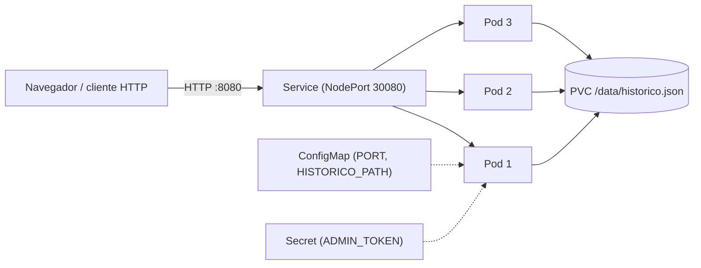
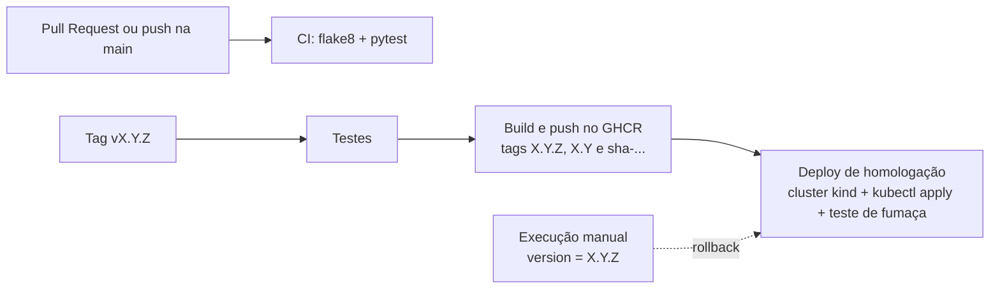

# Calculadora DevOps — Python

Projeto da disciplina Integração DevOps — CEUB 2026/2
Prof. Danilo Silva

Calculadora com interface web, API HTTP e histórico de operações, usada como
aplicação-alvo de um pipeline completo: integração contínua (CI), empacotamento
em contêiner, infraestrutura como código (Kubernetes e Docker Compose) e
entrega contínua (CD) com publicação no GitHub Container Registry (GHCR).

## Equipe

- **Davi** — Operações / Infraestrutura
- **Adrian** — Desenvolvedor
- **Pedro Vitor** — Qualidade (QA)

## Arquitetura



- **Aplicação** (`src/app.py`): servidor HTTP com a biblioteca padrão do Python.
  Serve o `frontend/index.html` e uma API JSON. Reaproveita
  `src/calculadora.py` (operações) e `src/banco.py` (histórico em JSON).
- **Persistência:** o histórico fica num arquivo JSON dentro de um volume
  (PVC no Kubernetes, volume nomeado no Compose). Os Pods dividem o mesmo
  arquivo e usam trava de arquivo para não perder gravações.
- **Configuração:** `PORT` e `HISTORICO_PATH` vêm de um ConfigMap; o
  `ADMIN_TOKEN` vem de um Secret criado fora do Git.
- **Réplicas:** o Deployment sobe 3 Pods atrás de um Service, com probes de
  saúde em `/healthz`.

### API

| Método e rota | Descrição |
|---|---|
| `GET /` | Página da calculadora (mostra o Pod que atendeu) |
| `GET /healthz` | Responde `ok` (probes do Kubernetes) |
| `GET /api/info` | Nome do Pod que atendeu |
| `GET /api/historico` | Lista o histórico |
| `POST /api/calcular` | Corpo `{"operacao","a","b"}`; calcula e grava. Divisão por zero e operação inválida retornam `400` |
| `DELETE /api/historico` | Limpa o histórico. Exige `Authorization: Bearer <ADMIN_TOKEN>`; sem ele, `401` |

Operações aceitas: `soma`, `subtracao`, `multiplicacao`, `divisao` (também
`somar`, `subtrair`, `multiplicar`, `dividir` e os símbolos `+ - * /`).

## Pipeline



- **CI** (`.github/workflows/ci.yml`): a cada Pull Request e push na `main`
  roda o linter (flake8) e os testes (pytest). A `main` é protegida: exige
  Pull Request, 1 aprovação e o check `build-and-test`.
- **CD** (`.github/workflows/cd.yml`): ao criar uma tag `vX.Y.Z`, roda os
  testes, constrói a imagem e a publica no GHCR com as tags `X.Y.Z`, `X.Y` e
  `sha-<commit>`. Em seguida faz o deploy num cluster Kubernetes efêmero
  (kind), aplica os manifestos de `k8s/` e executa um teste de fumaça.
- **Versionamento semântico:** cada release é uma tag Git e uma imagem
  imutável; a tag `sha-...` liga a imagem ao commit exato que a gerou.
- **Rollback:** Actions > "Pipeline CD - GHCR e Deploy" > Run workflow,
  informando a versão estável (por exemplo `1.0.0`). O pipeline não
  reconstrói nada: baixa a imagem daquela versão e reimplanta. Também é
  possível reverter direto no cluster. Passo a passo em
  [docs/ROLLBACK.md](docs/ROLLBACK.md).

### Segredos

Nenhuma senha ou token fica no código.

- **GHCR:** o login usa o `GITHUB_TOKEN` do próprio workflow, com a permissão
  `packages: write` declarada no job de publicação.
- **`ADMIN_TOKEN`:** cadastrado em Settings > Secrets and variables > Actions.
  O pipeline o injeta no cluster com `kubectl create secret`. O arquivo
  `k8s/exemplos/secret.example.yml` é só um modelo sem valor real.
- Localmente, o valor é passado por variável de ambiente ou por um `.env`
  (ignorado pelo Git).

## Como executar

### Local (sem contêiner)

```bash
pip install -r requirements-dev.txt
python -m src.app
```

Abra `http://localhost:8080`. Variáveis opcionais: `PORT`, `HISTORICO_PATH` e
`ADMIN_TOKEN` (necessário para limpar o histórico).

### Testes e linter

```bash
pytest tests/ -v
flake8 src/ tests/
```

### Docker

```bash
docker build -t calculadora:1.0.0 .
docker run --rm -p 8080:8080 -e ADMIN_TOKEN=troque-isto \
  -v calculadora_dados:/data calculadora:1.0.0
```

### Docker Compose

O `ADMIN_TOKEN` é obrigatório e vem de um arquivo `.env` local (ignorado
pelo Git):

```bash
echo "ADMIN_TOKEN=troque-isto" > .env
docker compose up --build -d
docker compose ps
docker compose down
```

O volume do histórico sobrevive ao `down` (use `down -v` para apagá-lo). Para usar a imagem publicada no
GHCR, veja os comentários no topo do `docker-compose.yml`.

### Kubernetes (Docker Desktop com Kubernetes ligado)

```bash
docker build -t calculadora:1.0.0 .
kubectl create secret generic app-secret --from-literal=ADMIN_TOKEN='troque-isto'
kubectl apply -f k8s/
kubectl set image deployment/calculadora-deployment calculadora=calculadora:1.0.0
kubectl get pods -w
kubectl port-forward service/calculadora-service 8080:8080
```

Limpeza: `kubectl delete -f k8s/` e `kubectl delete secret app-secret`.
O passo a passo de autocura, escala e balanceamento está em
[docs/A2-tarefas.md](docs/A2-tarefas.md).

## Evidências

A execução real dos cenários (subida, autocura, balanceamento, escala,
persistência e rollback) está registrada em
[docs/evidencias/evidencias-a2.md](docs/evidencias/evidencias-a2.md), com a
saída dos comandos.

Execuções do pipeline de CD (aba Actions):

- Tag `v1.0.0`: testes e publicação da imagem no GHCR com sucesso.
- Execução manual com `version = 1.0.0`: deploy de homologação com sucesso
  (baixa a imagem do GHCR, aplica os manifestos e passa no teste de fumaça).

## Análise de riscos

| Risco | Mitigação | Limite atual |
|---|---|---|
| Segredo vazar no código ou no histórico do Git | `ADMIN_TOKEN` só no GitHub Secrets e em Secret do cluster; `GITHUB_TOKEN` temporário para o GHCR | Quem tem permissão de escrita no repositório pode usar o secret em workflows |
| Perda de gravações com várias réplicas no mesmo arquivo | Trava de arquivo (`flock`) em `src/app.py` | O PVC é `ReadWriteOnce`: serve para 1 nó. Em cluster com vários nós, trocar o arquivo por um banco (por exemplo PostgreSQL) |
| Release com defeito | Imagens imutáveis e versionadas; rollback por pipeline ou `kubectl rollout undo`; o RollingUpdate mantém pods antigos no ar durante a falha | O deploy de homologação é simulado (cluster efêmero) |
| Dependência de ações de terceiros nos workflows | Versões fixadas por release principal | Sem fixação por hash |
| Vulnerabilidades em código, dependências e imagem | Imagem alpine enxuta, usuário sem root | SAST e varredura de contêiner ainda não estão no pipeline (próxima fase) |

## Post-mortem: falha no primeiro deploy de homologação

**O que aconteceu.** Ao criar a tag `v1.0.0`, os jobs de testes e de
publicação passaram, mas o deploy de homologação falhou no passo "Login no
GHCR e baixar a imagem da versão".

**Causa.** A imagem foi baixada normalmente. O erro veio do comando
`kind load docker-image`, que procurava um cluster chamado `kind`
(`no nodes found for cluster "kind"`), enquanto a ação `helm/kind-action` cria
o cluster com outro nome por padrão.

**Correção.** O cluster passou a ser criado com `cluster_name: homologacao` e
o `kind load` usa `--name homologacao` (Pull Request #10).

**Verificação.** A execução manual do workflow com `version = 1.0.0` concluiu
com sucesso, incluindo o teste de fumaça.

**Aprendizado.** O pipeline de CD só roda em tag, então um defeito nele só
aparece na primeira release. Antes de uma release importante, vale executar o
workflow manualmente numa versão já publicada para validar o deploy.

## Estrutura do projeto

```
.
├── .github/workflows/
│   ├── ci.yml                 # CI: linter e testes
│   └── cd.yml                 # CD: GHCR e deploy de homologação
├── docs/
│   ├── A2-tarefas.md          # Divisão de tarefas e roteiro local
│   ├── ROLLBACK.md            # Versionamento e rollback
│   └── evidencias/            # Log dos cenários executados
├── frontend/index.html        # Interface web
├── k8s/                       # Manifestos Kubernetes
│   ├── configmap.yml
│   ├── pvc.yml
│   ├── deployment.yml         # Deployment (3 réplicas) e Service
│   └── exemplos/secret.example.yml
├── src/
│   ├── app.py                 # Servidor HTTP
│   ├── banco.py               # Histórico em JSON
│   └── calculadora.py         # Operações
├── tests/                     # Testes automatizados (pytest)
├── .dockerignore
├── .flake8
├── Dockerfile
├── docker-compose.yml
├── pytest.ini
└── requirements-dev.txt
```
